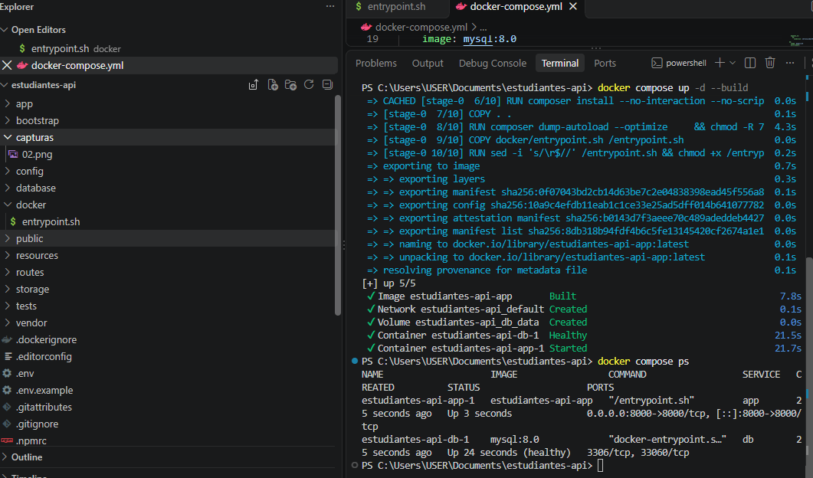
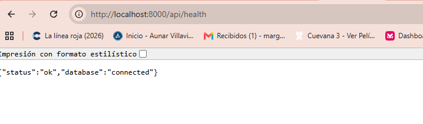
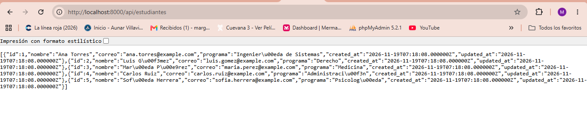
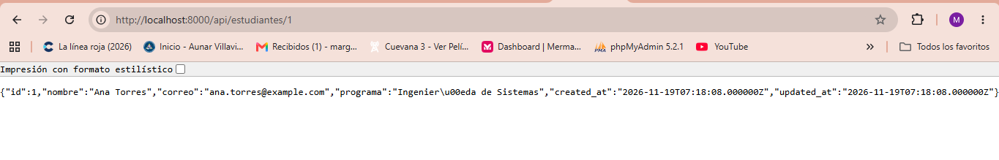
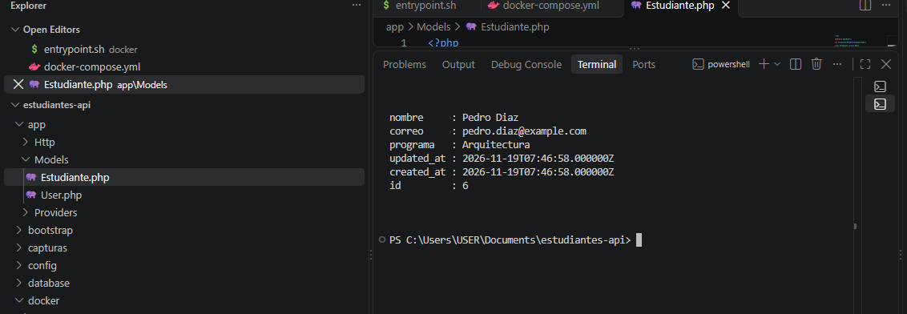
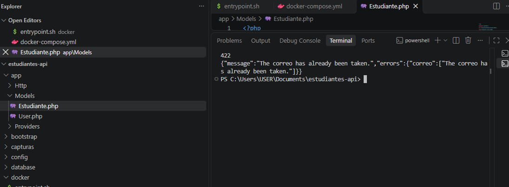

# API de estudiantes (Laravel + MySQL + Docker)

API REST en Laravel para registrar estudiantes. La aplicación (`app`) y MySQL (`db`) corren en contenedores separados y se levantan con Docker Compose.

## Requisitos

- Docker Desktop (incluye Docker Compose)

## Pasos de ejecución

1. Clonar el repositorio o descomprimir el .zip y entrar a la carpeta del proyecto.
2. Abrir Docker Desktop y esperar a que diga "Engine running".
3. Ejecutar:

   ```bash
   docker compose up --build
   ```

4. Esperar el mensaje `Server running on [http://0.0.0.0:8000]`. Las migraciones y el seeder (5 estudiantes) se ejecutan automáticamente al iniciar.
5. Probar en el navegador: http://localhost:8000/api/health

Para detener: `Ctrl + C` y luego `docker compose down`.
Para empezar con la base de datos limpia: `docker compose down -v`.

## Endpoints

| Método | Ruta | Descripción |
|---|---|---|
| GET | `/api/health` | Indica si la conexión a la base de datos funciona |
| GET | `/api/estudiantes` | Lista todos los estudiantes |
| POST | `/api/estudiantes` | Crea un estudiante (valida `nombre`, `correo` único y `programa`) |
| GET | `/api/estudiantes/{id}` | Muestra un estudiante o devuelve 404 |

Ejemplo de creación:

```bash
curl -X POST http://localhost:8000/api/estudiantes \
  -H "Content-Type: application/json" \
  -d '{"nombre":"Pedro Diaz","correo":"pedro.diaz@example.com","programa":"Arquitectura"}'
```

## ¿Por qué DB_HOST debe ser `db` y no `localhost`?

Cada contenedor tiene su propia red y su propio `localhost`. Dentro del contenedor `app`, `localhost` (127.0.0.1) apunta al propio contenedor `app`, donde no hay ningún MySQL escuchando, y la conexión es rechazada (`Connection refused`).

MySQL corre en otro contenedor, el servicio `db`. Docker Compose crea una red interna compartida por los servicios y un DNS que resuelve el nombre de cada servicio a la IP de su contenedor. Por eso `DB_HOST=db` (el nombre del servicio en `docker-compose.yml`) permite que `app` encuentre a MySQL. La IP puede cambiar entre ejecuciones, pero el nombre del servicio no.

## Capturas

### docker compose ps


### GET /api/health


### GET /api/estudiantes


### GET /api/estudiantes/1


### GET /api/estudiantes/999 (404)


### POST /api/estudiantes (crear)


### POST /api/estudiantes con datos inválidos (422)

